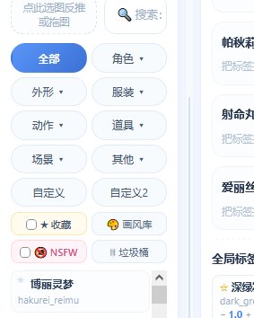
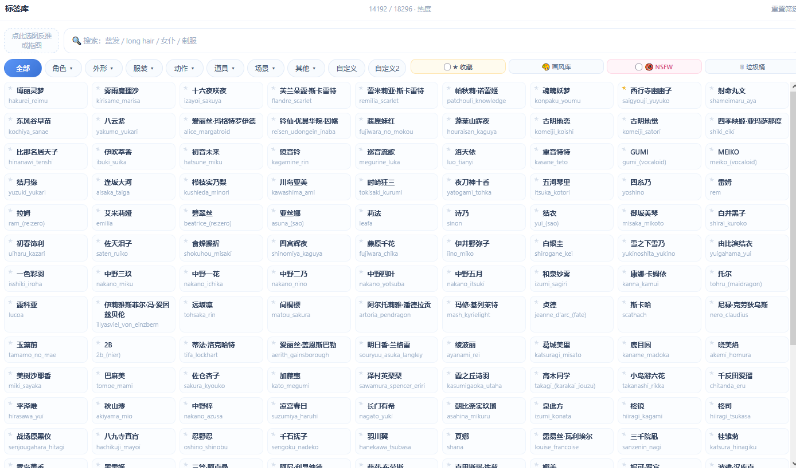
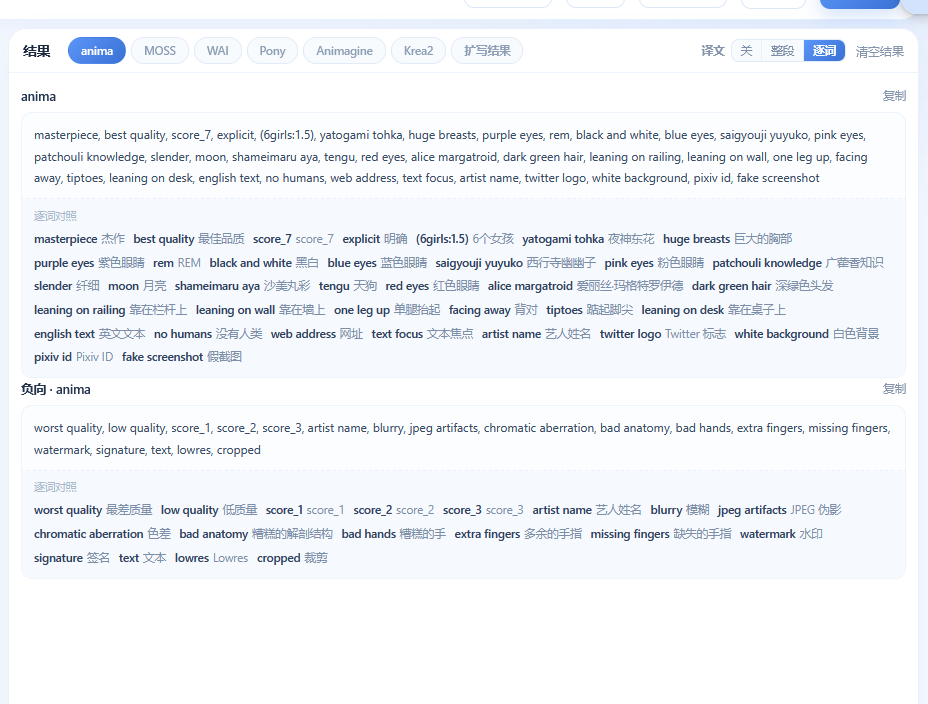

# 提示词工作台

基于 [Overstar66/prompt-workbench](https://github.com/Overstar66/prompt-workbench) 修改，仅作个人使用，与原仓库无隶属关系。

上游能力（图反推、AI 扩写、词库点选、MOSS / WAI / Pony 输出）全部保留，以下为在此基础上新增与修复的内容。

## 新增

**Anima 模型兼容**

- 适配 Anima 系列模型，作为独立分支置于结果区芯片首位。
- 按官方标签序输出：质量前缀 `masterpiece, best quality, score_7` → 人数 → 角色 → 场景。
- 按 Anima 写法处理标签：小写、下划线换空格（`score_*` 除外），权重上限 2.5。
- 独立正负向预设，不与 WAI / Pony 互串；NSFW 开关决定追加 `explicit` 还是 `safe`。

**提示词翻译**

- 结果区每个英文提示词下方给出中文译文，三档切换：关 / 整句 / 逐词对照。
- 后端 `/api/translate` 中转微软 Edge 免鉴权接口，词库之外的词也能译。
- 本地缓存最多 8000 条，同一提示词不重复请求。

**黑夜模式**

- 顶栏最左日夜开关，整页配色渐变过渡。
- 主题偏好写入 localStorage，首屏脚本同步应用，不闪白。

## 优化

**排版布局**

- 左栏扩写独立成卡片，默认高度收小、可拖动调高。
- 标签库与已选卡片内边距、行距、字号整体收一档，列数随窗口宽度自适应。
- 底部草稿 / 历史区高度下限下调，底边贴住窗口。

**拖拽交互**

- 已选区拖拽重写：全局区整块可投放、角色标签可拖回全局、高亮范围与实际可投放区一致、不再冒泡重复处理。

## 效果








## 修复

修复若干已知 bug（画风库、标签库、已选区拖拽、模型开关、图反推）。

## 其他

- 本地端口固定 `10086`（上游 `8901`），启动脚本已同步。

## 运行

```bash
pip install onnxruntime pillow numpy   # 仅图反推需要
python app.py
```

打开 <http://127.0.0.1:10086>；Windows 可直接双击 `启动工作台.bat`。

图反推需自备 WD14 模型，路径见 `wd14_mod.py` 顶部常量，可用环境变量 `WD14_MODEL` / `WD14_TAGS` 覆盖。

## 说明

更详细的教程见上游仓库：<https://github.com/Overstar66/prompt-workbench>

许可证沿用上游 MIT，详见 [LICENSE](LICENSE)。
